<!-- ═══════════════ HEADER ═══════════════ -->


<div align="center">

<a href="https://git.io/typing-svg">
  
</a>

<br/>


<a href="https://github.com/chrollow?tab=followers">
  
</a>
<a href="https://github.com/chrollow?tab=repositories">
  
</a>

</div>

<br/>

<!-- ═══════════════ ABOUT ═══════════════ -->
## 🧑‍💻 About Me

<table align="center">
<tr>
<td width="60%" valign="top">

```js
const donn = {
  role: "Full-Stack Developer",
  education: "BS Information Technology",
  currentlyLearning: ["Advanced Laravel", "React Native", "Python"],
  loves: ["Clean UI", "Building real products", "Solving problems"],
  funFact: "I debug with coffee and ship with confidence",
  lookingFor: "Opportunities to build, learn, and grow",
};
```

</td>
<td width="40%" valign="top">

 **Working on:** side projects & my portfolio
 **Learning:** modern UI with Tailwind & Aceternity UI
 **Open to:** collaborations & job opportunities
 **Ask me about:** PHP, Laravel, JavaScript, React Native
 **Goal:** write code people actually enjoy using

</td>
</tr>
</table>

<br/>

<!-- ═══════════════ TECH STACK ═══════════════ -->
## Tech Stack

<div align="center">


<br/><br/>


</div>

<br/>

<!-- ═══════════════ EXPAND SECTIONS (interactive) ═══════════════ -->
##  Explore More <sub>(click to expand)</sub>

<details>
<summary><b> What I'm good at</b></summary>
<br/>

| Area | Skills |
| :-- | :-- |
| 🌐 **Backend** | PHP, Laravel, Node.js |
| 🎨 **Frontend** | HTML5, CSS3, JavaScript, Tailwind CSS, Aceternity UI |
| 📱 **Mobile** | React Native |
| 🐍 **Scripting & Data** | Python |

</details>

<details>
<summary><b> Featured projects</b></summary>
<br/>

| Project | Description | Stack |
| :-- | :-- | :-- |
| 🔗 [**PharmAlala**](https://github.com/chrollow/PharmAlala) | A smartphone app called Pharmalala notifies pharmacists when medications are about to expire. | `React Native` `Tailwind` `MongoDb` |
| 🔗 [**UBheat**](https://github.com/chrollow/UBheat) | UBheat is a Philippine heatmap web app with AI linear regression. | `React Js` `Node.js` `MERN` `Python` `JavaScript` |
| 🔗 [**WEBTTRaC**](https://github.com/chrollow/WEBTTRaC) | WEBT-TRaC a transportation mobile app that will help manage the WEBT-TRac | `React Native` `JavaScript` |

</details>

<details>
<summary><b> My learning roadmap</b></summary>
<br/>

- [x] HTML, CSS & JavaScript fundamentals
- [x] PHP & Laravel
- [x] Tailwind CSS
- [x] React Native basics
- [x] Advanced Laravel (queues, testing, APIs)
- [x] Deeper Python (automation / data)
- [x] Deploying & DevOps basics

</details>

<details>
<summary><b> Random fun facts</b></summary>
<br/>

-  Powered by coffee and curiosity
-  Fresh BSIT graduate, ready to build
-  I love turning messy ideas into clean interfaces
-  Dark mode is the only mode

</details>

<br/>

<!-- ═══════════════ GITHUB STATS ═══════════════ -->
##  GitHub Stats

<div align="center">


<br/>


<br/><br/>


</div>

<br/>

<!-- ═══════════════ SNAKE (optional - needs the workflow file) ═══════════════ -->
<div align="center">
  <picture>
    <source media="(prefers-color-scheme: dark)" srcset="https://raw.githubusercontent.com/chrollow/chrollow/output/github-snake-dark.svg" />
    <source media="(prefers-color-scheme: light)" srcset="https://raw.githubusercontent.com/chrollow/chrollow/output/github-snake.svg" />
    
  </picture>
</div>

<br/>

<!-- ═══════════════ CONTACT ═══════════════ -->
##  How to Reach Me

<div align="center">

<a href="mailto:donnbaldoza2k@gmail.com">
  
</a>
<a href="https://www.linkedin.com/in/donn-anthony-baldoza-2950713a7/">
  
</a>
<a href="https://www.facebook.com/donnanthony.baldoza/">
  
</a>
<a href="https://github.com/chrollow">
  
</a>

<br/><br/>

<i>💡 "Make it work, make it right, make it fast."</i>

</div>

<!-- ═══════════════ FOOTER ═══════════════ -->

